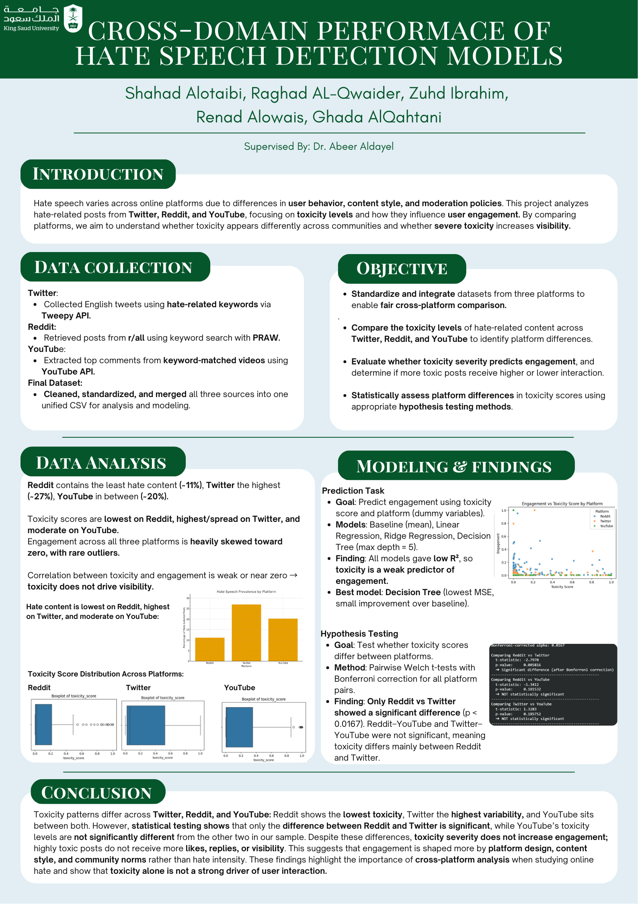

<h1 align="center">📊 Cross-Domain Performance of Hate Speech Detection Models</h1>

<b>Comparing Toxicity and User Engagement Across Reddit, Twitter, and YouTube</b>

  

---

## 📁 Project Overview

Hate speech does not look the same on every platform. This project collects posts and comments from **Reddit, Twitter, and YouTube**, scores their toxicity, and studies how toxic content differs across platforms and whether it attracts more engagement.

---

## 🎯 Research Questions

1. Is there a statistically significant difference in mean toxicity between the three platforms?
2. Does toxicity predict how much engagement a post receives?

---

## 🧪 Dataset

- **Source:** collected by our team in September 2025 using hate-related keywords
- **Platforms:**
  - Twitter: English tweets via the Tweepy API
  - Reddit: posts from r/all via PRAW
  - YouTube: top comments of keyword-matched videos via the YouTube Data API
- **Key Features:**
  - `Platform`
  - `Engagement`
  - `toxicity_score`
  - `Label`
  - `word_count`
  - `negative_word_count`

---

## 📌 Tools Used

- Python (Pandas, NumPy, Matplotlib, Seaborn)
- Scikit-learn and SciPy
- NLTK and Detoxify (text cleaning and toxicity scoring)
- Tweepy, PRAW, and Google API Client (data collection)
- Google Colab / Jupyter Notebook

---

## 🔬 Workflow

1. **Data collection and cleaning:** gathered data from three APIs, removed duplicates, URLs, mentions, emojis, and stopwords, and scored toxicity with Detoxify.
2. **Preprocessing and EDA:** standardized labels, normalized numeric features, explored distributions and correlations, and merged the three platforms into one dataset.
3. **Modeling:** hypothesis testing (ANOVA, Welch t-tests with Bonferroni correction) and regression models (Baseline, Linear, Ridge, Decision Tree) to predict engagement.

---

## 📈 Key Findings

### 1. Hate Content by Platform
📌 *Insight:* Reddit has the lowest share of hate content (~11%), YouTube is in between (~20%), and Twitter has the highest (~27%).

### 2. Toxicity Across Platforms
📌 *Insight:* Only **Reddit vs Twitter** showed a statistically significant difference in mean toxicity (p = 0.0058, below the Bonferroni threshold of 0.0167). Reddit vs YouTube and Twitter vs YouTube were not significant.

### 3. Predicting Engagement
📌 *Insight:* The **Decision Tree Regressor** (max depth = 5) had the lowest MSE, but only a small improvement over the baseline. Toxicity is a weak predictor of engagement.

---

## 🧠 Conclusion

Toxicity patterns differ between platforms, but toxic posts do not receive more likes, replies, or visibility. Engagement appears to depend more on platform design and community norms than on how hateful a post is.

---

## 👩‍💻 Team

- Ghada Alqahtani
- Shahad Alotaibi
- Raghad Al-Qwaider
- Zuhd Ibrahim
- Renad Alowais

Course: **IT 362 - Data Science Principles**, King Saud University.

This project was completed in November 2025.
